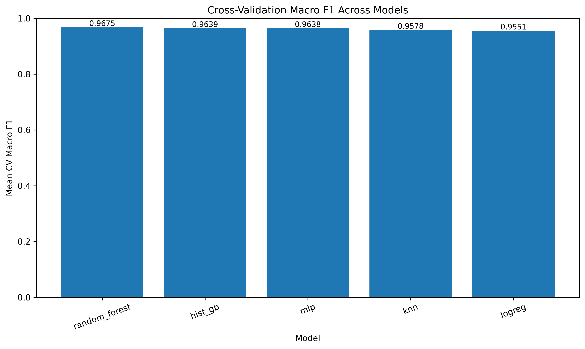
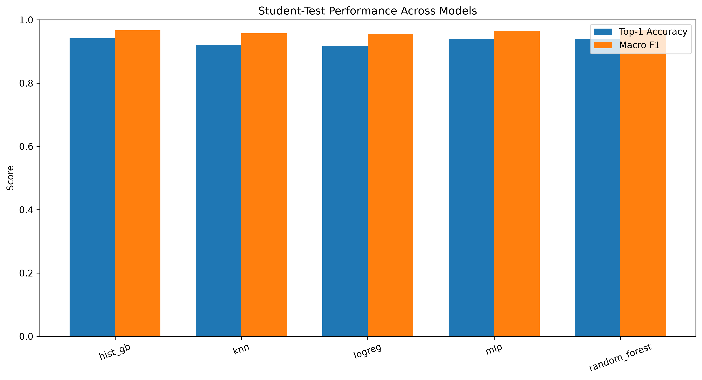
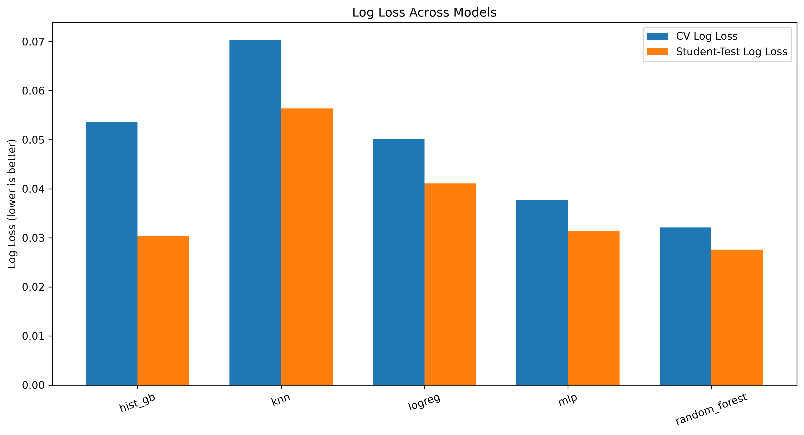

# 3. Model Experimentation and Comparison

## 3.1 Introduction

The objective of model experimentation was to identify a suitable machine learning classifier for matching GPS observations to candidate road segments.

Each GPS observation can have multiple nearby road-segment candidates. The classifier evaluates these candidates using engineered features and estimates the probability that each candidate corresponds to the correct road segment.

Five machine learning models were evaluated and compared:

1. Logistic Regression
2. K-Nearest Neighbours (KNN)
3. Multi-Layer Perceptron (MLP)
4. Random Forest
5. Histogram-based Gradient Boosting

The experiments considered classification performance, probability quality, generalisation across trips and computational efficiency.

## 3.2 Model Training and Validation Methodology

The candidate dataset was generated using the team's preprocessing and feature-engineering pipeline.

The training dataset contained approximately 1.83 million candidate rows before model training. Trip 00000033 was excluded from model training because its reference labels did not pass the heading-direction validation check. Therefore, 79 training trips were used.

The team used five-fold grouped cross-validation based on trip IDs.

In grouped cross-validation, all candidate observations belonging to a particular trip remain within the same fold. This prevents observations from the same trip from appearing in both training and validation partitions.

This approach provides a more reliable assessment of generalisation to previously unseen trips than randomly splitting individual candidate rows.

The final evaluation was performed using the 10 student-test trips.

## 3.3 Models Evaluated

### 3.3.1 Logistic Regression

Logistic Regression is a supervised classification algorithm that estimates the probability of a candidate belonging to the positive class.

It provides a relatively simple baseline and helps determine whether the engineered features can separate correct and incorrect road candidates using a linear decision boundary.

### 3.3.2 K-Nearest Neighbours (KNN)

K-Nearest Neighbours classifies observations based on the labels of nearby training observations in feature space.

It provides a distance-based comparison against the other classification approaches.

### 3.3.3 Multi-Layer Perceptron (MLP)

A Multi-Layer Perceptron is a feed-forward neural network that learns relationships between input features through interconnected layers.

It can model nonlinear relationships between geographical, directional and contextual features.

### 3.3.4 Random Forest

Random Forest is an ensemble learning algorithm that combines predictions from multiple decision trees.

Each tree learns different decision patterns from the training data, and their predictions are combined to produce a final classification probability.

Random Forest was selected as the final classifier because it achieved the strongest overall cross-validation results among the evaluated models.

### 3.3.5 Histogram-Based Gradient Boosting

Histogram-based Gradient Boosting is an ensemble method that builds decision trees sequentially, with each successive tree attempting to improve the predictions of the previous ensemble.

It was included to compare the performance of boosting-based classification against bagging-based Random Forest and the other models.

## 3.4 Model Comparison Results

The following table presents the recorded cross-validation and student-test results from `results/model_comparison.csv`.

| Model | CV Macro F1 | CV Log Loss | Test Top-1 | Test Macro F1 | Test Log Loss |
|---|---:|---:|---:|---:|---:|
| Logistic Regression | 0.9551 | 0.0502 | 0.9176 | 0.9561 | 0.0411 |
| KNN | 0.9578 | 0.0703 | 0.9201 | 0.9577 | 0.0563 |
| MLP | 0.9638 | 0.0377 | 0.9399 | 0.9646 | 0.0315 |
| Random Forest | **0.9675** | **0.0321** | 0.9405 | **0.9680** | **0.0276** |
| Histogram Gradient Boosting | 0.9639 | 0.0536 | **0.9421** | 0.9666 | 0.0304 |

The results show that Random Forest achieved the highest cross-validation Macro F1 score and the lowest cross-validation log loss.

Histogram-based Gradient Boosting achieved a slightly higher student-test Top-1 accuracy than Random Forest. However, Random Forest performed better in cross-validation Macro F1 and probability quality, making it the selected model based on the overall evaluation.

### Model Comparison Visualisation

The following chart compares the cross-validation Macro F1 scores of the five evaluated models.

The following chart compares Top-1 Accuracy and Macro F1 on the student-test partition.

The following chart compares cross-validation and student-test log loss.

## 3.5 Evaluation Metrics

The models were assessed using the following metrics:

**Top-1 Accuracy**

Measures the proportion of labelled GPS observations for which the highest-scoring candidate matches the reference road segment.

**Macro F1 Score**

Calculates the F1 score separately for each class and takes their unweighted average. This helps evaluate performance across both positive and negative candidate classes.

**Log Loss**

Measures the quality of predicted class probabilities. Lower values indicate that the predicted probabilities are better aligned with the actual labels.

**Route Continuity**

Measures the proportion of consecutive predicted road segments that are identical or connected according to the road network.

**Candidate Miss Rate**

Measures how often the correct reference road segment is absent from the generated candidate set.

These metrics provide complementary information about classification accuracy, probability quality and route reconstruction suitability.

## 3.6 Random Forest Model Selection

Random Forest was selected as the final classifier based on its cross-validation performance.

It achieved:

- Cross-validation Top-1 accuracy: 94.16%.
- Cross-validation Macro F1: 96.75%.
- Cross-validation log loss: 0.0321.
- Student-test Top-1 accuracy: 94.05%.
- Student-test Macro F1: 96.80%.
- Student-test log loss: 0.0276.

Although Histogram-based Gradient Boosting achieved a marginally higher student-test Top-1 accuracy, Random Forest demonstrated stronger cross-validation Macro F1 and lower cross-validation log loss.

The model was therefore selected based on overall performance rather than a single evaluation metric.

## 3.7 Final Model Configuration

The selected Random Forest model uses 29 engineered input features.

Its saved configuration includes:

| Parameter | Value |
|---|---:|
| Number of estimators | 247 |
| Maximum depth | 16 |
| Minimum samples per leaf | 6 |
| Maximum feature fraction | Approximately 0.7437 |
| Random seed | 42 |
| Training candidate rows | 359,066 |

The final trained model was exported to:

`models/artifacts/final_model.joblib`

Its feature configuration and model parameters are stored in:

`models/artifacts/model_config.json`

The model inference function adds a `p_match` probability column to the candidate table. These scores are subsequently used by the HMM decoder for route reconstruction.

## 3.8 Summary

Five classification algorithms were evaluated using grouped cross-validation and student-test data.

Random Forest was selected because it achieved the strongest cross-validation Macro F1 and probability-quality results. Its output probabilities provide the input required by the subsequent HMM and Viterbi route-reconstruction stage.

The model-selection process established the classification component used in the final PathSnap pipeline.