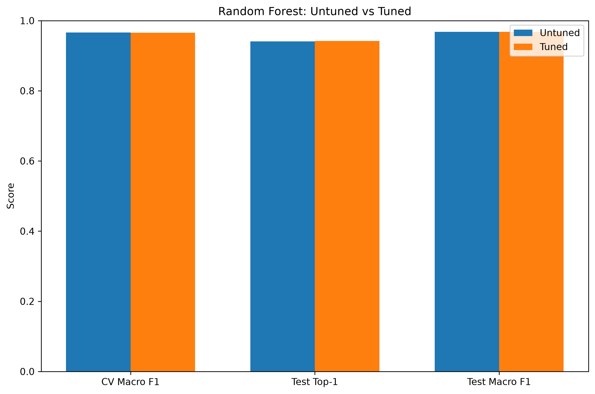

# 4. Bayesian Hyperparameter Optimisation

## 4.1 Introduction

Hyperparameter optimisation is the process of finding suitable configuration values that improve a machine learning pipeline's performance.

PathSnap uses Bayesian optimisation through the Optuna framework. The Tree-structured Parzen Estimator (TPE) sampler is used to explore different parameter combinations and identify promising configurations.

Bayesian optimisation was applied separately to candidate generation, Random Forest model training and HMM route decoding.

All tuning experiments followed the project requirement of using Bayesian optimisation rather than grid search or random search.

## 4.2 Candidate Generation Optimisation

### 4.2.1 Objective

Candidate generation identifies nearby road segments for each GPS observation.

The search radius and maximum number of candidates affect both the probability of including the correct road and the computational cost of subsequent processing.

A small search radius may exclude the correct road segment, while generating too many candidates increases unnecessary classification and decoding work.

The objective was to find a configuration that balances candidate coverage and computational efficiency.

### 4.2.2 Search Parameters

Two parameters were optimised:

| Parameter | Search range |
|---|---|
| Search radius | 60–100 metres |
| Maximum candidates | 4–40 |

The optimisation used 40 Optuna trials with the TPE sampler. Trip 00000033 was excluded from candidate tuning.

The objective function was:

Objective = Miss Rate + 0.0005 × Average Candidates

The miss rate measures how frequently the reference road segment is absent from the candidate list. The average candidate count represents the computational workload generated for each GPS observation.

### 4.2.3 Results

The best recorded trial used:

| Parameter | Value |
|---|---:|
| Search radius | 60 metres |
| Maximum candidates | 22 |
| Average candidates | 9.91 |
| Reference candidate miss rate | 0.0395% |
| Objective score | 0.005348 |

The final implementation retained a 60-metre search radius and a maximum of 24 candidates per GPS observation.

Candidate counts between 22 and 28 produced similar performance. A maximum of 24 was retained to match the configuration used during final model training.

The final candidate configuration is implemented in `features/candidates.py`.

## 4.3 Random Forest Hyperparameter Optimisation

### 4.3.1 Objective

After selecting Random Forest as the final classification model, Bayesian optimisation was applied to improve its hyperparameter configuration.

The objective was to improve classification performance and probability quality while maintaining reasonable computational efficiency.

### 4.3.2 Optimisation Method

The team used Optuna with the TPE sampler to explore Random Forest hyperparameters.

The experiment used 12 trials, with a time limit of 900 seconds and a search fraction of 0.05.

The optimisation was performed using training data and grouped validation by trip.

### 4.3.3 Final Model Parameters

The final tuned Random Forest configuration was:

| Hyperparameter | Final value |
|---|---:|
| Number of estimators | 247 |
| Maximum depth | 16 |
| Minimum samples per leaf | 6 |
| Maximum feature fraction | 0.743748 |
| Random seed | 42 |

### 4.3.4 Untuned and Tuned Model Comparison

The following results are taken from `results/tuning/random_forest_tuned_vs_untuned.csv`.

| Metric | Untuned Random Forest | Tuned Random Forest |
|---|---:|---:|
| CV Top-1 accuracy | 93.71% | 94.00% |
| CV Macro F1 | 96.59% | 96.58% |
| CV Log Loss | 0.03336 | 0.03291 |
| Student-test Top-1 | 94.05% | 94.18% |
| Student-test Macro F1 | 96.80% | 96.83% |
| Student-test Log Loss | 0.02758 | 0.02708 |
| Route continuity | 95.77% | 95.87% |

The tuned model showed improvements in Top-1 accuracy, log loss and route continuity. Macro F1 remained almost unchanged.

These results indicate that Bayesian optimisation produced a modest but measurable improvement in the selected Random Forest configuration.

## 4.4 HMM Decoder Hyperparameter Optimisation

### 4.4.1 Objective

The Random Forest classifier independently scores candidate road segments. However, selecting the highest-scoring candidate at every GPS observation may produce a sequence of road segments that is not geographically connected.

The HMM decoder uses transition information and candidate probabilities to reconstruct a more consistent route.

Its configuration parameters influence how the decoder balances candidate probabilities, route transitions and movement constraints.

### 4.4.2 Optimisation Method

The HMM decoder was tuned separately using Optuna and Bayesian optimisation.

The team performed 30 trials using held-out scores from the final Random Forest model.

This ensured that decoder tuning was performed using the final classifier rather than the earlier temporary baseline model.

### 4.4.3 Classifier and HMM Comparison

The final updated results are taken from `hmm/outputs/hmm_comparison.csv`.

| Metric | Classifier Only | Classifier + HMM |
|---|---:|---:|
| Student-test Top-1 accuracy | 94.18% | 96.74% |
| Route continuity | 95.71% | 98.18% |
| Reachable continuity | 98.60% | 99.98% |
| Route F1 | 96.71% | 98.67% |

The results show that the HMM improved both classification accuracy and route consistency.

The increase in route continuity indicates that sequence decoding helps reduce disconnected road-segment predictions.

## 4.5 Summary of Bayesian Optimisation

Bayesian optimisation was applied at three levels of the PathSnap pipeline:

| Component | Optimisation trials | Main purpose |
|---|---:|---|
| Candidate generation | 40 | Balance candidate coverage and computational cost |
| Random Forest | 12 | Improve classification and probability performance |
| HMM decoder | 30 | Improve route reconstruction and continuity |

The experiments demonstrate that optimisation was not limited to the machine learning classifier. Candidate generation and route decoding were also tuned to improve the complete map-matching pipeline.

The final configuration combines a 60-metre candidate search radius, a maximum of 24 candidates per observation, a tuned Random Forest classifier and an optimised HMM decoder.

### Random Forest Tuning Visualisation

The following chart compares the untuned and Bayesian-optimised Random Forest model.

