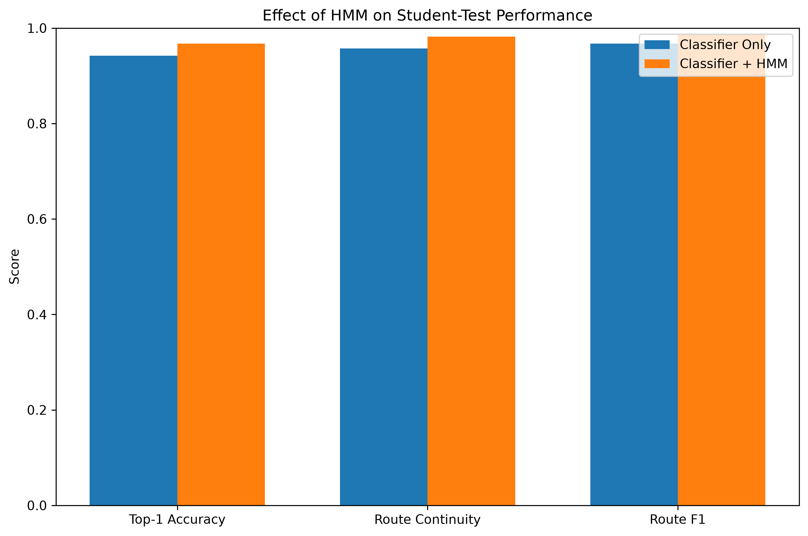

# 5. HMM-Based Route Reconstruction Using the Viterbi Algorithm

## 5.1 Motivation

The Random Forest classifier assigns a matching probability to each candidate road segment for an individual GPS observation. Selecting the candidate with the highest probability independently at every observation can produce an inconsistent route.

For example, two consecutive GPS observations may be individually matched to road segments that are geographically close but are not connected through the directed road network. This can result in unrealistic jumps between roads.

To address this limitation, PathSnap uses a Hidden Markov Model (HMM) with the Viterbi algorithm to reconstruct a more consistent sequence of road segments.

The HMM considers both the classifier's matching probabilities and the feasibility of travelling between consecutive candidate road segments.

## 5.2 Hidden States and Observations

The HMM is applied to the candidate road segments generated for each GPS observation.

- **Observation:** A GPS point recorded by the device.
- **Hidden state:** A candidate directed road segment associated with that GPS point.
- **Emission score:** The Random Forest classifier's predicted matching probability (`p_match`) for the candidate segment.
- **Transition score:** A measure of how plausible it is to move from a candidate segment at the previous GPS point to a candidate segment at the current GPS point.

The classifier probabilities are used as emission scores. The decoder evaluates these scores together with road-network travel distances to identify a likely sequence of hidden states.

## 5.3 Emission Scores

The emission score represents how likely a candidate road segment is to match the observed GPS point, according to the trained Random Forest classifier.

The implementation uses the logarithm of the predicted probability:

\[
E_t(j)=w_e\log(\max(p_{t,j},p_{\min}))
\]

Where:

- \(p_{t,j}\) is the classifier's matching probability for candidate \(j\) at observation \(t\).
- \(w_e\) is the emission weight.
- \(p_{\min}\) is the minimum probability used to prevent taking the logarithm of zero.

The final configuration uses an emission weight of 1.0 and a minimum probability of \(10^{-6}\).

Using logarithmic probabilities allows the decoder to combine scores across a sequence without multiplying many small probabilities directly.

## 5.4 Transition Scores and Road Connectivity

The transition score evaluates whether movement from one candidate road segment to another is consistent with the observed GPS movement.

The implementation compares:

1. The straight-line GPS distance between two consecutive observations.
2. The estimated driving distance between the corresponding candidate road segments through the road network.

If both distances are reasonably similar, the transition receives a better score.

For a transition with a finite driving route, the implementation calculates:

\[
T(i,j)=-\frac{|D_{\text{route}}-D_{\text{GPS}}|+P_{\text{backward}}}{S}
\]

Where:

- \(D_{\text{route}}\) is the estimated driving distance between the candidate positions.
- \(D_{\text{GPS}}\) is the straight-line distance between consecutive GPS observations.
- \(P_{\text{backward}}\) is an additional penalty for excessive backward movement along the same road segment.
- \(S\) is the transition scale, adjusted according to the time gap between observations.

The road router uses bounded shortest-path searches over directed road-network arcs. This allows the decoder to consider actual road connectivity rather than simply measuring the distance between two road segments.

If no drivable connection is found within the search radius, the transition receives a fixed unreachable penalty instead of immediately breaking the decoding process.

The implementation also handles long GPS jumps separately. If the distance between consecutive observations exceeds the configured break distance, the decoder starts a fresh route segment rather than forcing an implausible connection.

## 5.5 Viterbi Dynamic Programming

The Viterbi algorithm identifies the most likely sequence of hidden states by considering the best possible path up to each observation.

The recurrence implemented in `hmm/viterbi.py` is:

\[
V_t(j)=E_t(j)+\max_i\left(V_{t-1}(i)+T_{t-1}(i,j)\right)
\]

Where:

- \(V_t(j)\) is the best cumulative score ending at candidate \(j\) at observation \(t\).
- \(E_t(j)\) is the emission score of candidate \(j\).
- \(T_{t-1}(i,j)\) is the transition score from the previous candidate \(i\) to the current candidate \(j\).
- The maximum operation selects the best preceding state.

The algorithm stores back-pointers during the forward calculation. After processing the observations, it starts from the highest-scoring final state and traces the back-pointers in reverse order to recover the selected sequence.

This is more efficient than checking every possible complete sequence of road segments.

If a GPS observation has no candidate road segments, it is returned with an arc ID of `-1`. The implementation also supports restarting the route after very long GPS jumps.

## 5.6 HMM Decoder Configuration

The final decoder configuration is stored in `hmm/hmm_config.json`.

| Parameter | Final value | Purpose |
|---|---:|---|
| Emission weight | 1.0 | Weight assigned to classifier probability scores |
| Transition scale | 1.9455 m | Controls the sensitivity of transition scores |
| Unreachable penalty | 43.2095 | Penalty for transitions without a drivable connection |
| Search radius | 300 m | Minimum bounded road-search radius |
| Route slack factor | 2.0 | Allows the search radius to expand with GPS distance |
| Break distance | 1,500 m | Starts a fresh route segment after a large GPS jump |
| Backward tolerance | 39.6217 m | Tolerance for backward movement along the same arc |
| Minimum probability | 0.000001 | Prevents logarithm of zero |

The transition search radius can expand according to the observed GPS distance and the route slack factor. Therefore, 300 metres is the minimum configured search radius, not necessarily the radius used for every transition.

## 5.7 Decoder Tuning and Data Leakage Prevention

The HMM decoder is tuned using classifier scores generated without allowing the classifier to train on the trips used for decoder tuning.

The `hmm/final_scores.py` implementation uses three-fold GroupKFold splitting based on trip IDs. One group of training trips is held out, while the classifier is fitted on a sample of the remaining training data.

The implementation uses:

- Three grouped folds.
- A 20% sample of the fitting data.
- The selected Random Forest model configuration.
- Candidate scores generated for every GPS point in the held-out trips.

The student-test trips are scored using the exported final trained model.

Importantly, every GPS point is scored, including points without a reliable reference label. This reflects deployment conditions, where the decoder must process the complete GPS track.

Reference routes are used only during evaluation to calculate metrics. They are not passed into the candidate generation or decoding process.

## 5.8 Evaluation Metrics

The decoder is evaluated using point-level accuracy, route continuity and route-level F1 score.

**Top-1 Accuracy**

Measures the proportion of labelled GPS observations for which the predicted road segment matches the reference road segment.

\[
Accuracy=\frac{\text{Correct predictions}}{\text{Labelled observations}}
\]

**Route Continuity**

Measures the proportion of consecutive valid predictions that are either on the same directed road segment or on directly connected directed segments.

**Reachable Continuity**

Also accepts a short drivable path between consecutive predicted segments. This accounts for cases where a vehicle may travel across a short road segment between two GPS observations.

**Route F1 Score**

Measures the overlap between the predicted and reference road networks, using road-segment lengths to calculate precision and recall.

\[
F1=2\times\frac{Precision\times Recall}{Precision+Recall}
\]

This provides a route-level measure in addition to point-by-point accuracy.

## 5.9 Classifier-Only Versus HMM Results

The final evaluation on the student-test partition shows that adding HMM-based route reconstruction improves both point-level matching and route consistency.

| Metric | Classifier only | HMM + Viterbi |
|---|---:|---:|
| Top-1 Accuracy | 94.18% | 96.74% |
| Route Continuity | 95.71% | 98.18% |
| Reachable Continuity | 98.60% | 99.98% |
| Route F1 Score | 96.71% | 98.67% |

The HMM improves Top-1 Accuracy by approximately 2.56 percentage points and Route F1 Score by approximately 1.96 percentage points.

The improvement in route continuity indicates that considering road-network transitions helps reduce inconsistent changes between predicted road segments.

Reachable continuity reaches 99.98%, showing that almost all consecutive valid predictions can be connected through a short drivable path under the evaluation definition.

## 5.10 Conclusion

The HMM and Viterbi decoder improve the PathSnap system by combining Random Forest matching probabilities with road-network connectivity and GPS movement information.

Instead of choosing the best road segment independently for every GPS point, the decoder evaluates the complete sequence and selects the highest-scoring route.

The final student-test results demonstrate improvements in Top-1 Accuracy, route continuity and route-level F1 Score. This makes the reconstructed route more consistent with the directed road network and more suitable for practical map-matching applications.

### Classifier and HMM Performance Visualisation

The following chart illustrates the improvement obtained by applying HMM-based route reconstruction.

