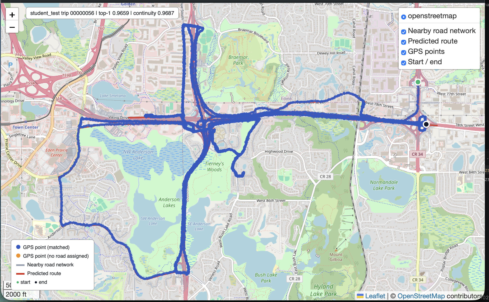
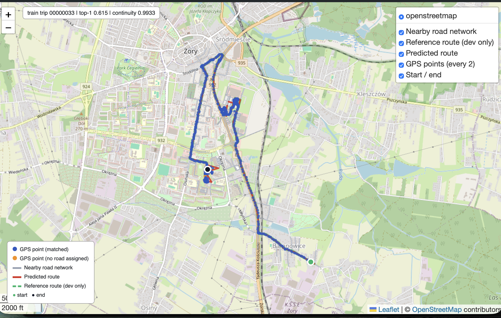

# 6. Geographical Visualisation Using Folium

## 6.1 Introduction

Geographical visualisation is an important part of the PathSnap map-matching system because it allows the reconstructed route to be inspected visually.

While evaluation metrics provide numerical measurements of model performance, maps help identify how GPS observations align with the road network and whether the predicted route follows a plausible driving path.

The project uses Folium, a Python library for creating interactive geographical maps using Leaflet.js.

The visualisation module is implemented in `visualisations/route_map.py`.

## 6.2 Map Layers

The PathSnap visualisation provides four main geographical layers.

### 1. Original GPS Observations

The GPS observations represent the coordinates recorded by the device during a trip.

The points are displayed as small circular markers on the map. Their colours indicate whether the prediction pipeline assigned a road segment:

- Blue: GPS point with an assigned road segment.
- Orange: GPS point without an assigned road segment.

For long trips, the visualisation reduces the number of displayed GPS markers to keep the HTML map manageable. The implementation uses a maximum drawing target of 2,000 GPS markers.

This thinning is only for visualisation. It does not remove observations from model inference or route reconstruction.

### 2. Nearby Road Network

The nearby road-network layer displays road segments located within the geographical area surrounding the GPS track.

The implementation uses a spatial KD-tree (`cKDTree`) to identify road-network nodes within 150 metres of the GPS track.

The corresponding directed road arcs are then displayed as grey lines.

This provides geographical context and helps determine whether the predicted route follows the available road network.

### 3. Reference Route

The reference route represents the known route associated with a development or evaluation trip.

It is displayed as a green dashed line.

The reference route is useful for visually comparing the reconstructed route against the known route during development and evaluation.

However, the implementation restricts this layer to the `train` and `student_test` partitions. It is not intended to be exposed in a production evaluation interface.

The reference route is used for visual inspection and evaluation, not as an input to the prediction pipeline.

### 4. Predicted Route

The predicted route is generated by the actual PathSnap prediction pipeline.

The visualisation calls:

`pipeline.predict(trip_dir, log_prefix="map")`

The returned route is displayed as a red line.

The pipeline uses the trained Random Forest model to score candidate road segments and the HMM with Viterbi decoding to reconstruct a consistent route.

This ensures that the geographical visualisation displays predictions produced by the same pipeline used by the API.

## 6.3 Start and End Markers

The map also displays separate markers for the beginning and end of each trip.

- Green marker: Starting location.
- Dark marker: Ending location.

These markers help users understand the direction and geographical extent of the reconstructed journey.

## 6.4 Interactive Map Features

The maps are created using Folium and OpenStreetMap tiles.

The implementation includes:

- Interactive map navigation and zooming.
- Layer control to show or hide individual geographical layers.
- Tooltips containing GPS observation and predicted arc information.
- A custom legend explaining the colours and symbols.
- Automatic map bounds based on the GPS track.
- A title displaying the trip ID and evaluation metrics.

The layer control makes it possible to inspect the GPS observations, nearby roads, reference route and predicted route separately or together.

## 6.5 Implementation Details

The main visualisation functions are implemented in `visualisations/route_map.py`.

| Function | Responsibility |
|---|---|
| `to_metres()` | Converts longitude and latitude coordinates into a local metre-based coordinate system |
| `nearby_arcs()` | Finds road-network arcs close to the GPS track using a KD-tree |
| `arc_lines()` | Converts road arcs into coordinate sequences suitable for map drawing |
| `legend_html()` | Creates the custom map legend |
| `build_map()` | Runs prediction and constructs the complete interactive map |
| `main()` | Handles command-line arguments and saves the generated maps |

The implementation uses the same prediction pipeline as the API. This avoids differences between the routes shown in the visualisation and the routes returned by the deployed application.

## 6.6 Generating the Maps

The visualisation supports generating a map for an individual trip or for every trip in a selected partition.

Example command for an individual training trip:

```bash
python -m visualisations.route_map --trip 00000033 --partition train
```

Example command for all student-test trips:

```bash
python -m visualisations.route_map --all --partition student_test
```

The generated interactive HTML files are saved in:

```text
visualisations/output/
```

The output filenames follow the format:

```text
<partition>_<trip_id>.html
```

For example:

```text
student_test_00000056.html
```

The `--no-reference` option can be used to hide the reference route when generating a map.

## 6.7 Data Separation and Evaluation Integrity

The visualisation module uses the prediction pipeline to generate the predicted route.

Reference routes are drawn only for the permitted development partitions and are not passed into the model's prediction process.

This distinction is important because the system must reconstruct routes using GPS observations and road-network information rather than relying on the known answer.

The map therefore provides a visual representation of the prediction while preserving the separation between model inputs and evaluation references.

## 6.8 Conclusion

The Folium-based geographical visualisation provides an interactive way to inspect PathSnap's map-matching results.

By displaying GPS observations, nearby road geometry, reference routes and predicted routes, the system makes it easier to understand the relationship between raw GPS data and the reconstructed journey.

Using the same prediction pipeline as the API also ensures consistency between the visualisation and the deployed application.

## 6.9 Geographical Visualisation Examples

### Student-Test Route Prediction

The following map shows the predicted route for student-test trip 00000056. It displays the original GPS observations, nearby road network and predicted route without exposing the reference route.



### Training Trip Route Comparison

The following map shows training trip 00000033, including the GPS observations, nearby road network, predicted route and reference route. This allows visual comparison between the reconstructed route and the known route.

